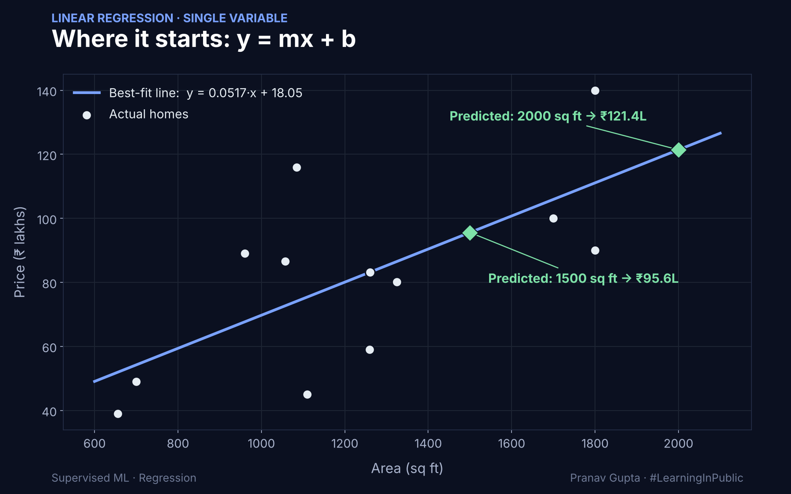

# AI & Machine Learning

My complete AI/ML learning repository, from math and statistics through machine learning, deep learning and NLP, to Generative AI and agentic systems.

I'm an automation engineer (RPA) moving into AI engineering. Everything here is hands-on: each topic has a notebook, the dataset it uses, and the results it produced. I'm following the [Codebasics AI Engineering & Data Science Bootcamp](https://codebasics.io) and adding my own notes and experiments along the way.



## Progress

| # | Module | Status | Highlights |
|---|---|---|---|
| 01 | [Math & Statistics](01-math-and-statistics) | ✅ Done | Probability, distributions, hypothesis testing, A/B testing |
| 02 | [Machine Learning](02-machine-learning) | 🟡 In progress | **Regression ✅** · Classification · Ensembles · Unsupervised · ML lifecycle |
| 03 | [Deep Learning](03-deep-learning) | ⏳ Not started | PyTorch, CNNs, transfer learning, RNN/LSTM, Transformers |
| 04 | [NLP](04-nlp) | ⏳ Not started | Text preprocessing, TF-IDF, embeddings, spaCy, Hugging Face, BERT |
| 05 | [Gen AI & Agentic AI](05-gen-ai-and-agentic-ai) | ⏳ Not started | LLMs, RAG, LangChain, LangGraph, CrewAI, MCP, AI agents |
| ⭐ | [Projects](projects) | ⏳ Not started | End-to-end, deployed projects for each module |

## Latest work: Regression

| Notebook | What it does | Result |
|---|---|---|
| [Linear regression](02-machine-learning/01-regression/01-linear-regression) | Predicts home price from area with `y = mx + b` | `price = 0.0517·area + 18.05` |
| [Multiple linear regression](02-machine-learning/01-regression/02-multiple-linear-regression) | Adds bedrooms as a feature, then recalculates the prediction by hand to confirm it matches `model.predict()` | ₹106.83L both ways |
| [Train-test split & metrics](02-machine-learning/01-regression/03-train-test-split) | Predicts car fuel efficiency on the UCI Auto MPG dataset (398 cars), with missing-value handling and an 80/20 split | **R² = 0.85**, MSE = 8.2 |
| [One-hot encoding](02-machine-learning/01-regression/04-one-hot-encoding) | Encodes a text `locality` column with `drop_first=True` to avoid multicollinearity | **R² = 0.86** on test data |
| [Exercise: weather](02-machine-learning/01-regression/exercises/01-weather-temperature) | Predicts daily temperature from sunlight hours, then from sunlight + humidity | |

See the [Machine Learning module](02-machine-learning) for the full topic list and notes.

## Repository structure

```
├── 01-math-and-statistics/
├── 02-machine-learning/
│   └── 01-regression/
│       ├── 01-linear-regression/
│       ├── 02-multiple-linear-regression/
│       ├── 03-train-test-split/
│       ├── 04-one-hot-encoding/
│       └── exercises/
├── 03-deep-learning/
├── 04-nlp/
├── 05-gen-ai-and-agentic-ai/
├── projects/
└── assets/
```

Each module folder has its own README with the topics it covers and a checklist of my progress. Inside a module, every topic gets its own folder with the notebook and its data.

## Tech stack

**Used so far:** Python · pandas · scikit-learn · Jupyter

**Coming up in this repo:**

| Area | Tools |
|---|---|
| Data & math | NumPy, Matplotlib, Seaborn |
| Machine learning | XGBoost, MLflow |
| Deep learning | PyTorch, Optuna |
| NLP | spaCy, Hugging Face Transformers |
| Gen AI & agents | LangChain, LangGraph, CrewAI, ChromaDB, MCP, Amazon Bedrock AgentCore |
| Apps & deployment | Streamlit, FastAPI |

## Run it locally

```bash
git clone https://github.com/hauntedguest/machine-learning.git
cd machine-learning
python -m venv .venv && source .venv/bin/activate   # Windows: .venv\Scripts\activate
pip install -r requirements.txt
jupyter notebook
```

Open each notebook from its own folder so the relative data paths resolve. Some notebooks download public datasets (for example UCI Auto MPG), so they need an internet connection.

## Connect

I post what I learn on [LinkedIn](https://www.linkedin.com/in/pranav-gupta-264438228/). Feedback and suggestions are welcome; feel free to open an issue.
